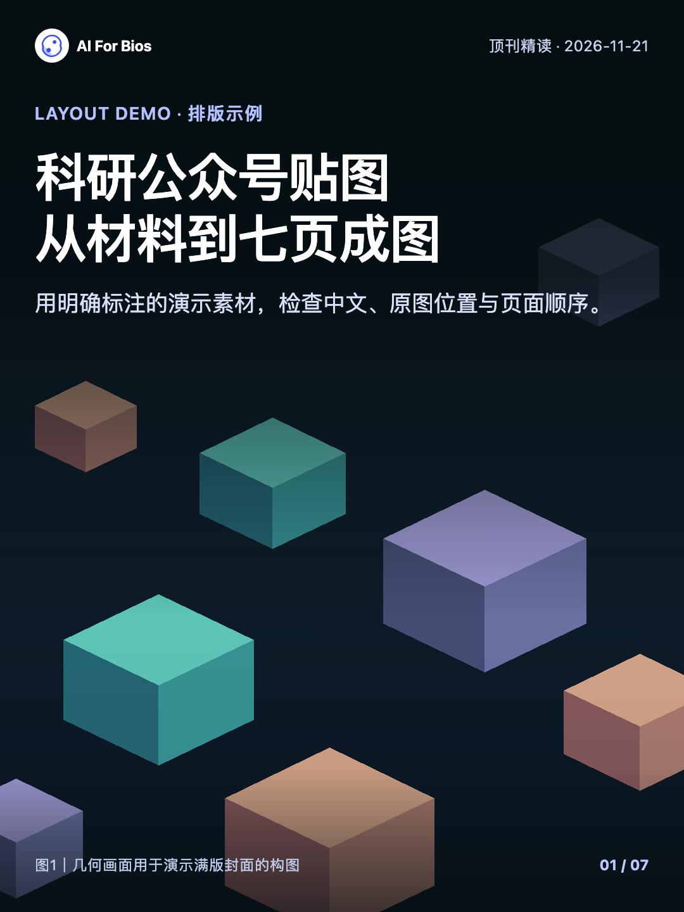
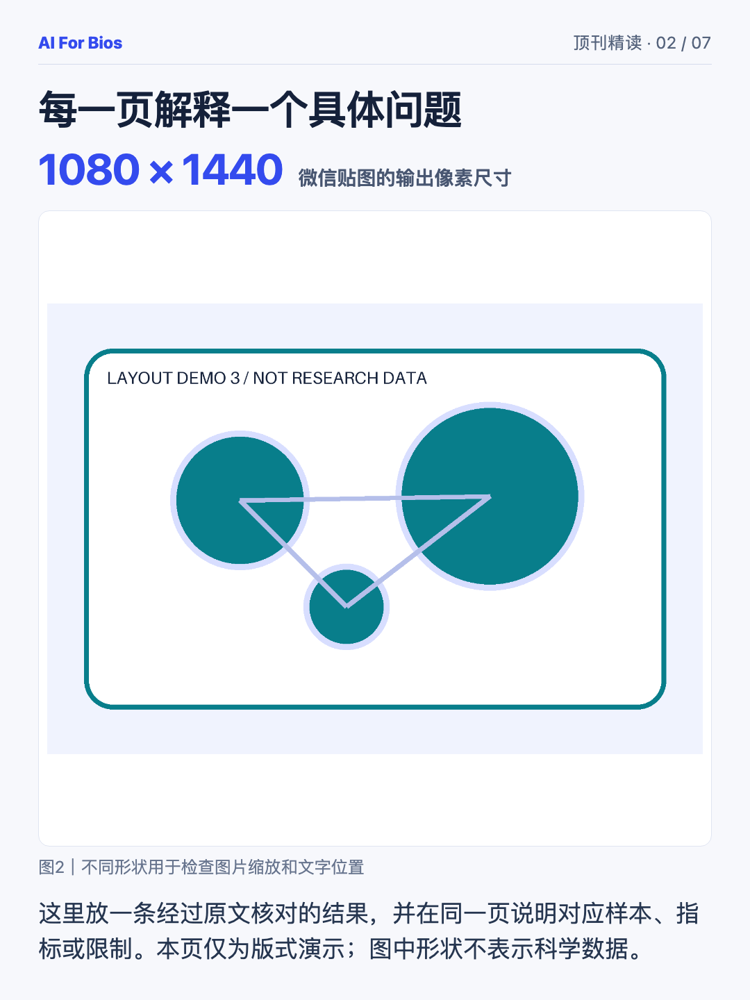
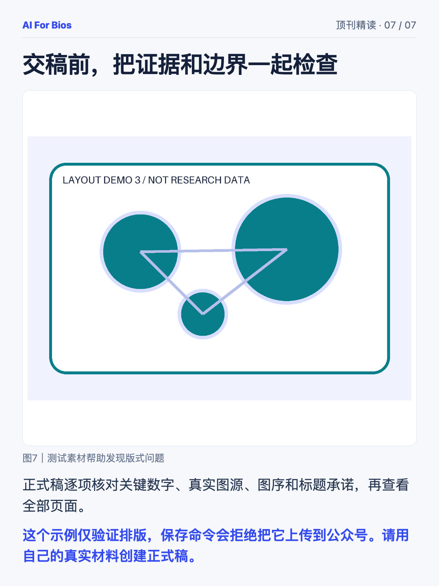
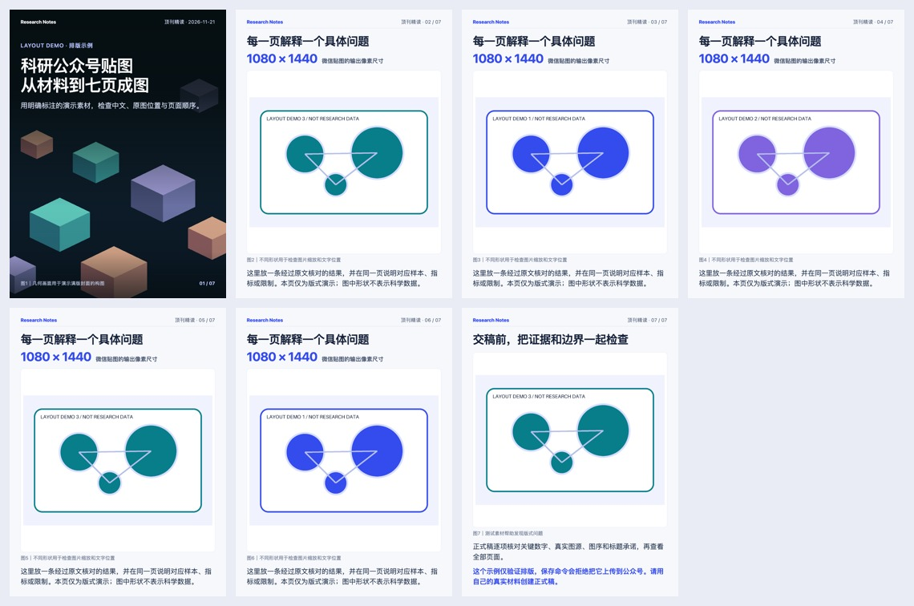

<p align="center">
  <picture>
    <source media="(prefers-color-scheme: dark)" srcset="assets/brand/ai-for-bios-horizontal-dark.png">
    
  </picture>
</p>

<h1 align="center">WeChat Newspic Skill</h1>

<p align="center"><strong>把论文与科研资讯，做成有来源的公众号贴图。</strong></p>

<p align="center">
  <a href="https://github.com/yetong0516/wechat-newspic-skill/releases"></a>
  <a href="https://github.com/yetong0516/wechat-newspic-skill/actions/workflows/ci.yml"></a>
  <a href="requirements.txt"></a>
  <a href="LICENSE"></a>
</p>

<p align="center">
  <a href="#效果预览">效果预览</a> ·
  <a href="#快速开始">快速开始</a> ·
  <a href="#在-codex-中使用">安装技能</a> ·
  <a href="references/wechat-delivery.md">草稿</a> ·
  <a href="references/cover-design.md">设计</a>
</p>

来自 **AI For Bios** 的科研内容工作流：核对来源、安排页序、渲染图片，再把审核后的内容保存到公众号草稿箱。每篇 **3–20页，1080×1440**；可作为Codex技能使用，也可单独运行Python工具。

## 效果预览

<table>
  <tr>
    <td align="center" valign="top" width="33%">
      <a href="assets/previews/showcase-cover.png"></a><br>
      <strong>满版封面</strong><br>
      <sub>底图铺满画布，标题直接叠加。</sub>
    </td>
    <td align="center" valign="top" width="33%">
      <a href="assets/previews/showcase-evidence.png"></a><br>
      <strong>证据页</strong><br>
      <sub>原图、数字与条件一起看。</sub>
    </td>
    <td align="center" valign="top" width="33%">
      <a href="assets/previews/showcase-ending.png"></a><br>
      <strong>结论与限制</strong><br>
      <sub>说明结果的适用范围。</sub>
    </td>
  </tr>
</table>

<p align="center"><sub>仓库脚本生成的排版样例，使用明确标注的演示素材。点击图片查看原尺寸。</sub></p>

<details>
<summary><strong>展开完整七页样例</strong></summary>



演示图由仓库脚本绘制，用于检查中文、布局和页面顺序；不表示实验结果。运行示例标记为`demo_only`，保存命令会拒绝上传。正式稿请换成有来源和许可记录的图片。

</details>

## 快速开始

准备 **Python 3.9+** 和 Git。以下命令以macOS/Linux终端为例；Linux建议安装Noto CJK字体，macOS使用系统中文字体。

```bash
git clone https://github.com/yetong0516/wechat-newspic-skill.git
cd wechat-newspic-skill
python3 -m venv .venv
source .venv/bin/activate
python -m pip install -r requirements.txt
python -m playwright install chromium

python scripts/newspic.py render examples/demo
python scripts/newspic.py validate examples/demo
```

用浏览器打开`examples/demo/newspic.html`，或查看同目录的`newspic-01.png`起的图片。**本地出图无需微信账号。**

<details>
<summary><strong>七页演示、交付预检与自己的练习稿</strong></summary>

```bash
python scripts/newspic.py render examples/demo-seven
python scripts/newspic.py validate examples/demo-seven
python scripts/wechat_draft.py plan examples/demo-seven

python scripts/create_demo.py output/my-demo --pages 7
```

`plan`只做本地检查，网络请求数为0。正式内容另放在默认被Git忽略的`drafts/`中；更换文字或素材后重新渲染，再查看成图。

</details>

## 在 Codex 中使用

仓库根目录就是完整技能包。按[官方文档](https://learn.chatgpt.com/docs/build-skills)，在仓库根目录把它链接到Codex个人技能目录：

```bash
mkdir -p "$HOME/.agents/skills"
ln -s "$PWD" "$HOME/.agents/skills/wechat-newspic"
```

已有同名技能时先检查，不要覆盖。Codex会自动发现技能变化，未出现时重启客户端。随后可直接提出任务：

> 用`$wechat-newspic`根据这篇论文做一组公众号贴图。按内容决定页数，保留实验设置、关键数字和限制。先给我全部本地预览。

技能负责指导助手研究和编辑，脚本负责渲染与检查。正式素材的来源、许可、文件哈希和尺寸逐图记录；旧PNG与修改后的内容不一致时，检查不会通过。

## 保存到公众号草稿箱

本地审阅完成后，可以连接自己的公众号保存草稿。凭证使用环境变量`WECHAT_APP_ID` / `WECHAT_APP_SECRET`，或仓库外的私有配置文件，详见[草稿交付文档](references/wechat-delivery.md)。

```bash
python scripts/wechat_draft.py inspect drafts/my-post
# 仅在这篇稿件已获准保存后执行：
python scripts/wechat_draft.py save drafts/my-post --confirm-draft-save
python scripts/wechat_draft.py verify drafts/my-post
```

保存前完整分页查重，保存后回读标题、文案、封面与所有图片。**仅存草稿，不发布、不群发、不删除。**

<details>
<summary><strong>已有草稿、后台修改与失败重试</strong></summary>

- 已有稿使用`--update EXISTING_MEDIA_ID --snapshot drafts/my-post/.wechat/snapshot.json`。先把用户后台编辑合入本地，上传期间后台再有变化时，脚本会停止更新。
- 保存结果不确定时，先`inspect`找回同一ID，再`verify`；不要重复创建。
- 40164时按微信返回的当前IP配置白名单。工具不改系统代理或VPN；`--direct`仅控制当前进程是否采用环境代理。
- 私有运行记录位于被Git忽略的`.wechat/`，包括快照、上传缓存与回读证据。

</details>

## 示例与文档

| 想做什么 | 从这里开始 |
| --- | --- |
| 跑通第一组图片 | [三页示例](examples/demo) · [七页示例](examples/demo-seven) |
| 从论文组织内容 | [技能说明](SKILL.md) · [Science序列诊断配方](examples/sequential-diagnosis) |
| 选封面、调整裁切与Logo | [封面设计](references/cover-design.md) |
| 编辑JSON、整理图源 | [内容与素材规范](references/content-contract.md) |
| 保存、更新和恢复草稿 | [交付与故障处理](references/wechat-delivery.md) |

Science示例提供编辑文字、论文链接和裁图坐标。自备合法取得的正式PDF可在本地复现；论文PDF、图片及公众号后台记录不随仓库分发。

## 开发与验证

```bash
python -m unittest discover -s tests -v
python scripts/check_public_export.py
```

测试覆盖重复稿、分页、UTF-8、后台编辑、上传中断、只读恢复、PNG标志和远端图片差异。GitHub Actions还实际渲染三页与七页示例，测试不调用真实公众号账号。独立工具来自已用于七页草稿保存与完整回读的产线，来源见[提取记录](docs/provenance.json)。

## 许可

采用上游[BSL 1.1条款](LICENSE)，属于公开源码（source-available）。学习、评估和约定的非商业用途按LICENSE执行；商业使用需要另行许可。第三方图片与依赖适用各自的条款，见[来源及版权说明](THIRD_PARTY_NOTICES.md)。

BioSpark · AI For Bios<br>
Based on BioSpark WeChat OA Automation Pipeline<br>
Copyright (c) 2026 BioSpark / AI For Bios<br>
Licensed under BSL 1.1<br>
https://github.com/yetong0516/BioSpark_AI-For-Bios_WeChat-OA-Automation-Pipeline
